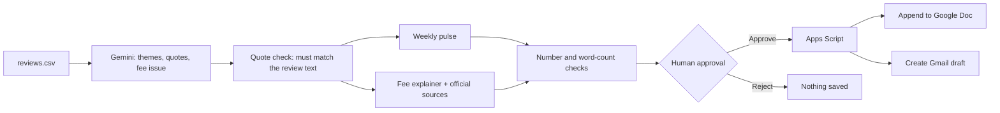

# Review Pulse

Turns recent ChatGPT Play Store reviews into a **weekly product pulse** for the product team and a **fee explainer** for the support team, then saves both to a Google Doc and prepares a Gmail draft, only after a human approves.

| | |
|---|---|
| **Live app** | [LIVE_URL](https://chatgpt-review-pulse.vercel.app/) |
| **Google Doc (saved entries)** | [GOOGLE_DOC_URL](https://docs.google.com/document/d/10k5w4DoAaMo3m73dTi0aFtdx8DUTsTANDhDJH79U51I/edit?usp=sharing) |
| **Product** | ChatGPT (Android app, India Play Store reviews) |
| **Stack** | Next.js (JavaScript), Gemini API (free tier), Google Apps Script, Vercel |

## What it does

1. **Review intelligence.** Reads `data/reviews.csv` (26 reviews, 21 Jul to 18 Sep 2026), groups them into at most 5 themes, picks the top 3, extracts 3 quotes, and flags 1 recurring fee or charge confusion.
2. **Weekly product pulse.** A structured note of 250 words or fewer: top themes, user quotes, key observation, 3 action ideas.
3. **Fee explainer.** Up to 6 neutral, facts-only bullets, 2 official source links, and a "Last checked" date.
4. **Approval-gated actions.** After you click **Approve and save**, the app appends the entry to a Google Doc and creates a Gmail draft. Nothing is sent automatically.

## What fee issue was identified from the reviews

**Unexpected or unwanted subscription charges, failed free-trial payments, and refund requests.**

6 of the 26 reviews support it (R08, R21, R22, R23, R24, R26). Examples of what users reported:

- A free-trial payment that fails with "Payment was not approved".
- An account that was upgraded to a paid plan without the user's intent.
- Requests for a refund after a subscription did not meet expectations.
- Free-tier limits feeling worse after cancelling.

The explainer is built only from OpenAI's official Help Center pages on cancelling and refunds (saved in `data/sources/`). The exact title of the issue can vary slightly between runs, because the model words it each time. The supporting reviews stay the same.

## How it works



Controls that keep the output trustworthy:

- **Quote verification.** Every quote is checked against the original review text. Quotes that do not match are dropped from the pulse.
- **Grounded explainer.** The model sees only the fee issue and the saved official pages. Numbers in the bullets (for example "7 days") are checked against that source text.
- **Fixed links and date.** The two source links and the "Last checked" date are added by code, not written by the model.
- **Single analysis run.** The pulse and the explainer are built from the same analysis, so they always agree.

## Where MCP-style approval happens

- **Approval gate:** the **Approval required** panel on the page. It shows exactly what will be saved and offers **Approve and save** or **Reject**. No action runs before the click.
- **Tool call:** `src/app/api/approve/route.js` sends the approved entry to the Google Apps Script web app in `apps-script/Code.gs`.
- **Actions performed by the script:** append to the Google Doc, and create a Gmail **draft** (it calls `createDraft`, never `send`).
- **Protection:** the script rejects any request without a shared secret.

This follows the assignment's "function calling with an approval step" option. It is an MCP-style, approval-gated tool call, not a full MCP server.

## How to run

**Prerequisites:** Node.js 20+ and a free Gemini API key from https://aistudio.google.com/apikey.

```bash
git clone https://github.com/Create-source1/chatgpt-review-pulse.git
cd chatgpt-review-pulse
npm install
cp .env.example .env.local     # on Windows PowerShell: Copy-Item .env.example .env.local
```

Fill in `.env.local`:

| Variable | Purpose |
|---|---|
| `GEMINI_API_KEY` | Your Gemini key (never commit it) |
| `GEMINI_MODEL` | Model name, for example `gemini-3.8-flash` |
| `APPS_SCRIPT_URL` | Web app URL of your deployed Apps Script |
| `APPS_SCRIPT_SECRET` | Same value as the script's `SECRET` property |

Then start the app:

```bash
npm run dev
```

Open http://localhost:3000 and click **Generate weekly update**. A run takes about 1 to 2 minutes on the free tier. The page shows each step as it runs.

### Set up the Google Doc and Gmail actions (one time)

1. Create a Google Doc and copy its ID (the part of the URL between `/d/` and `/edit`).
2. At https://script.google.com create a project and paste in `apps-script/Code.gs`.
3. In **Project Settings, Script properties**, add `DOC_ID`, `DRAFT_TO` (the email that should receive the draft) and `SECRET` (a long random string).
4. Run `testRun` once from the editor and approve the permissions.
5. **Deploy, New deployment, Web app**: Execute as *Me*, access *Anyone*. Copy the `/exec` URL into `APPS_SCRIPT_URL`.

### Deploy to Vercel

Import the repo on Vercel, add the four environment variables above, and deploy. `next.config.mjs` includes the `data/` folder in the build so the CSV and source files are available at runtime.

## Project structure

```
chatgpt-review-pulse/
├─ src/
│  ├─ app/
│  │  ├─ page.js                 UI: pipeline progress, results, approval panel
│  │  └─ api/
│  │     ├─ analyze/             themes, quotes, fee issue
│  │     ├─ pulse/               weekly product pulse
│  │     ├─ explain/             fee explainer
│  │     ├─ approve/             approval-gated call to Apps Script
│  │     ├─ generate/            single-call version of the full pipeline
│  │     └─ reviews/             data-loading check
│  └─ lib/                       llm.js, prompts.js, analyze.js, pulse.js,
│                                explainer.js, reviews.js, sources.js
├─ data/
│  ├─ reviews.csv                26 public Play Store reviews
│  └─ sources/                   notes from the official OpenAI help pages
├─ apps-script/Code.gs           Doc append and Gmail draft
├─ docs/                         sources list and sample outputs
├─ .env.example                  variable names only, no secrets
└─ README.md
```

## Deliverables

| Item | Where |
|---|---|
| Working prototype | [LIVE_URL](https://chatgpt-review-pulse.vercel.app/) |
| Weekly product pulse | Shown in the app and saved in the Google Doc |
| Notes/Doc snippet with appended entry | [GOOGLE_DOC_URL](https://docs.google.com/document/d/10k5w4DoAaMo3m73dTi0aFtdx8DUTsTANDhDJH79U51I/edit?usp=sharing) and `docs/` |
| Email draft | `docs/` (screenshot) |
| Reviews CSV sample | `data/reviews.csv` |
| Source list | `docs/sources.md` |

## Sources

The full list is in [`docs/sources.md`](docs/sources.md). The fee explainer links to two official OpenAI Help Center pages:

- Canceling your ChatGPT subscription: https://help.openai.com/en/articles/7232927
- How do I request a refund for my ChatGPT subscription: https://help.openai.com/en/articles/7232895-how-do-i-request-a-refund-for-my-chatgpt-subscription

## Limitations

- **Small sample.** 26 reviews across about 8.5 weeks. Themes and counts are directional, not statistically conclusive.
- **Model variation.** Theme names and the fee-issue title can change slightly from run to run. Quotes and numbers are always checked against the source.
- **Manually captured sources.** The official pages were copied on 17 Oct 2026. "Last checked" shows the date the app was run, so re-copy the pages into `data/sources/` when you want a fresh check.
- **Free-tier speed.** Generation takes 1 to 2 minutes because it runs on a free LLM tier.
- **Public URL.** Anyone with the link can generate or approve. For wider sharing, add an access code.